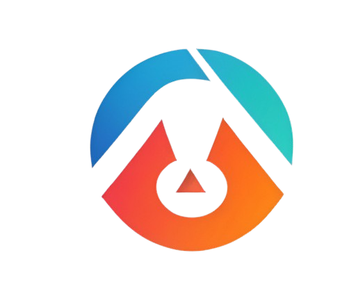
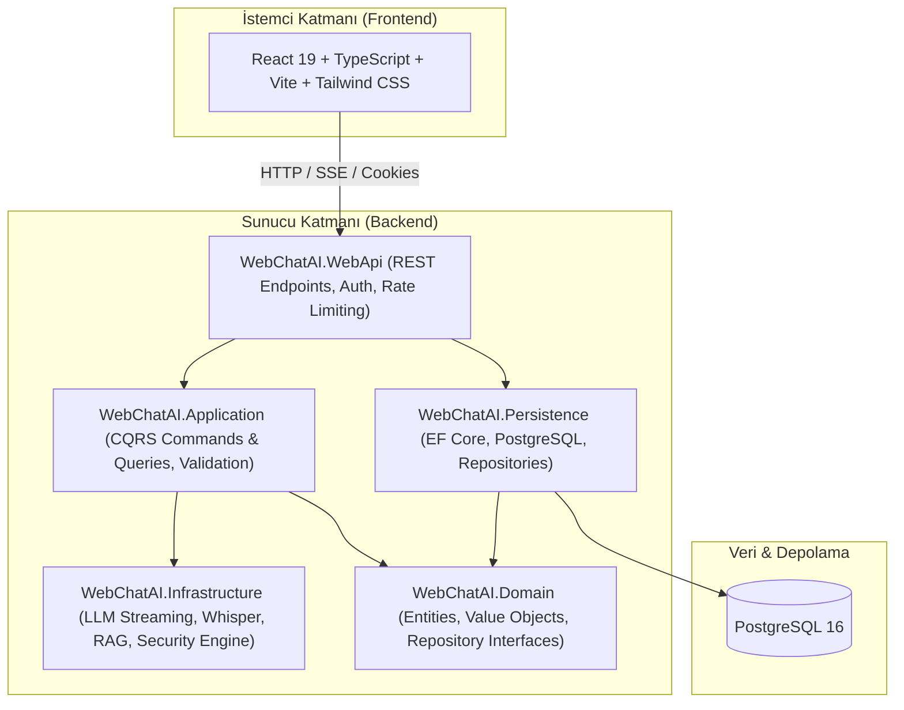

# 🚀 DevPilot AI — Enterprise AI Workspace & Security Scanner

<p align="center">
  
</p>

<p align="center">
  <strong>Gelişmiş Yapay Zekâ Sohbeti, Sesli İletişim, RAG Doküman Analizi ve Dış Yüzey Güvenlik Değerlendirme Platformu</strong>
</p>

<p align="center">
  <a href="#-özellikler"></a>
  <a href="#-özellikler"></a>
  <a href="#-özellikler"></a>
  <a href="#-özellikler"></a>
  <a href="#-özellikler"></a>
  <a href="#-testler"></a>
  <a href="#-lisans"></a>
</p>

---

## 📖 Genel Bakış

**DevPilot AI**, kurumsal standartlarda geliştirilmiş modern bir yapay zekâ asistanı ve pasif dış güvenlik denetim platformudur. 

Kullanıcılarına yüksek hızlı **LLM akışlı yanıtlar**, **sesli mesajlaşma (Whisper AI)**, **akıllı doküman analizi (RAG)** ve kamuya açık web hedeflerinin dış güvenlik duruşunu analiz eden **salt-okunur pasif güvenlik tarayıcısı** sunar.

Proje, kurumsal ölçeklenebilirlik için **Clean Architecture (Onion)**, **CQRS (MediatR)**, **Entity Framework Core**, **PostgreSQL** ve modern **React 19 (Vite + Tailwind CSS)** teknolojileriyle inşa edilmiştir.

---

## ✨ Temel Özellikler

| Modül | Açıklama |
| :--- | :--- |
| 💬 **Gerçek Zamanlı AI Sohbeti** | Groq & LLM sağlayıcıları üzerinden token-by-token HTTP streaming ile gecikmesiz sohbet deneyimi. |
| 🎙️ **Sesli Mesaj & Transkripsiyon** | Whisper altyapısıyla ses kayıtlarının (WAV/Blob) anında metne çevrilmesi ve sesli sorgulara yapay zekâ yanıtı. |
| 📚 **RAG & Akıllı Doküman QA** | PDF ve TXT belgelerinden otomatik metin çıkarma, anlamsal parçalama (chunking) ve bağlamsal doküman analizi. |
| 🛡️ **Pasif Dış Güvenlik Tarayıcısı** | Kamuya açık web siteleri için saldırgan olmayan, salt-okunur güvenlik başlıkları, SSL/TLS, CORS, DNS ve `robots.txt`/`security.txt` keşif motoru. |
| 🔑 **BYOK (Kendi Anahtarını Getir)** | Kullanıcıların kendi AI API anahtarlarını AES-256 ile şifrelenmiş kasada güvenle saklayabilmesi ve sınırsız kullanabilmesi. |
| ⚡ **Atomik Günlük Kota Motoru** | Eşzamanlı isteklerde yarış durumlarını (race condition) engelleyen veritabanı seviyesinde atomik kota ve kredi takip altyapısı. |
| 🔒 **Kurumsal Güvenlik** | SSRF koruması, güvenli yönlendirme denetimi, hesap bazlı hız sınırlandırma (Rate Limiting), JWT & Refresh Token rotasyonu ve HttpOnly çerez desteği. |

---

## 🏗️ Mimari Yapı

DevPilot AI, katmanlar arası bağımlılıkları minimize eden **Clean Architecture** prensiplerine sadıktır:



---

## 🚀 Hızlı Başlangıç & Yerel Kurulum

Projeyi yerel bilgisayarınızda test etmek için **iki kolay yöntem** mevcuttur:

### Yöntem 1: Docker Compose ile Tek Komutla Çalıştırma (Önerilen) 🐳

En hızlı ve sorunsuz kurulum yöntemidir. Bilgisayarınızda **Docker Desktop**'ın kurulu olması yeterlidir:

1. **Depoyu klonlayın:**
   ```bash
   git clone https://github.com/kullanici-adiniz/DevPilot-AI.git
   cd DevPilot-AI
   ```

2. **Ortam dosyasını hazırlayın:**
   ```bash
   cp .env.example .env
   ```
   *(Opsiyonel: `.env` dosyasını açıp kendi API anahtarlarınızı veya şifrelerinizi belirleyebilirsiniz. Varsayılan yerel değerler test için hazırdır.)*

3. **Sistemi ayağa kaldırın:**
   ```bash
   docker compose up -d --build
   ```

4. **Uygulamaya erişin:**
   - **Frontend (Web Arayüzü):** `http://localhost:3000`
   - **Backend API:** `http://localhost:5000`
   - **Etkileşimli API Dokümantasyonu (Scalar):** `http://localhost:5000/scalar/v1`

---

### Yöntem 2: Geliştirici Modunda Manuel Kurulum 💻

Geliştirme veya kod üzerinde değişiklik yapmak için:

#### Önkoşullar
- [.NET 9 SDK](https://dotnet.microsoft.com/download/dotnet/9.0)
- [Node.js (v20 veya üzeri)](https://nodejs.org/)
- [PostgreSQL (v15 veya üzeri)](https://www.postgresql.org/)

#### 1. Veritabanı & Backend Başlatma
```bash
# Backend dizinine geçin
cd Backend/WebChatAI

# Bağımlılıkları geri yükleyin
dotnet restore

# Geliştirme ortamında çalıştırın
dotnet run --project WebChatAI.WebApi
```
Backend `http://localhost:5000` adresinde hizmet vermeye başlayacaktır.

#### 2. Frontend Başlatma
```bash
# Yeni bir terminalde React dizinine geçin
cd React-UI

# Paketleri yükleyin
npm install

# Geliştirme sunucusunu başlatın
npm run dev
```
Frontend `http://localhost:5173` adresinde açılacaktır.

---

## 🧪 Testlerin Çalıştırılması

DevPilot AI, güvenlik kurallarını, yönlendirme doğrulamalarını, atomik kota mekanizmalarını ve iş kurallarını test eden kapsamlı bir regresyon test paketine sahiptir.

### Backend Test Paketi (xUnit)
```bash
dotnet test Backend/WebChatAI/WebChatAI.Tests/WebChatAI.Tests.csproj
```
> **Test Durumu:** 147 testin tamamı **0 hata** ile başarıyla sonuçlanmaktadır (`147 Passed`).

### Frontend Derleme ve Tip Testi
```bash
cd React-UI
npm run build
```
TypeScript statik analizi ve Vite derleme kontrollerini sıfır uyarı/hata ile tamamlar.

---

## 🤖 Yapay Zekâ & Güvenlik Çalışma Özeti (`AI_LOG.md`)

DevPilot AI, yüksek güvenlikli mimari standartlarına uyum için çok aşamalı güvenlik sertleştirmelerinden (hardening) geçirilmiştir.

Ayrıntılı teknik kararlar, SSRF koruma katmanları, atomik kota algoritmaları ve doğrulama matrisi için lütfen **[AI_LOG.md](AI_LOG.md)** belgesini inceleyin.

### Öne Çıkan Güvenlik & Mimari Garantiler:
- **SSRF & Private IP Filtresi:** Tarama motoru RFC 1918, RFC 3927, loopback ve bulut metadata adreslerini kesin olarak reddeder.
- **Güvenli Yönlendirme:** Dış yönlendirmelerde scheme, host ve yetkili port sınırı korunur; yetkisiz port geçişleri engellenir.
- **Eşzamanlılık & Atomik Kota:** Kullanıcı kredileri ilişkisel veritabanında `ExecuteUpdateAsync` ile atomik düşülür, yarış durumları önlenir.
- **Dürüst Sesli Mesaj Hata İadesi:** Ses transkripsiyonu veya yapay zekâ hatasında kredi tüketildiyse idempotent olarak iade edilir ve kullanıcıya doğru bilgi verilir.
- **Fail-Closed Ortam Denetimi:** Yapılandırma eksikliğinde sistem daima en güvenli üretim moduna (fail-closed) kilitlenir.

---

## 📂 Dizin Yapısı

```text
DevPilot AI/
├── Backend/                    # .NET 9 Clean Architecture Çözümü
│   └── WebChatAI/
│       ├── WebChatAI.Domain/           # Varlıklar ve temel arayüzler
│       ├── WebChatAI.Application/      # CQRS komutları, sorguları ve validasyonlar
│       ├── WebChatAI.Infrastructure/   # Dış servisler, LLM, Whisper, Güvenlik motoru
│       ├── WebChatAI.Persistence/      # EF Core DbContext, PostgreSQL ve depolar
│       ├── WebChatAI.WebApi/           # API Controller'ları, güvenlik ara yazılımları
│       └── WebChatAI.Tests/            # 147 adet xUnit birim ve entegrasyon testi
├── React-UI/                   # React 19 + TypeScript + Tailwind SPA
│   ├── src/                    # Bileşenler, sayfalar, hook'lar ve servisler
│   └── public/                 # Görsel varlıklar ve logolar
├── .env.example                # Örnek ortam değişkenleri şablonu
├── .gitignore                  # Git takip dışı dosyalar
├── docker-compose.yml          # Çoklu konteyner orkestrasyon dosyası
├── AI_LOG.md                   # AI geliştirme ve sertleştirme denetim raporu
└── README.md                   # Bu tanıtım ve kullanım kılavuzu
```

---

## 🛡️ Sorumlu Kullanım & Gizlilik

- Bu yazılım salt-okunur güvenlik başlıkları ve yapılandırma kontrolleri yapmak üzere tasarlanmıştır.
- SQL injection, brute-force veya exploit gibi aktif saldırı testleri içermez ve yapmaz.
- Canlı ortamlarda yalnızca yetkiniz olan alan adlarını tarayınız.

---


